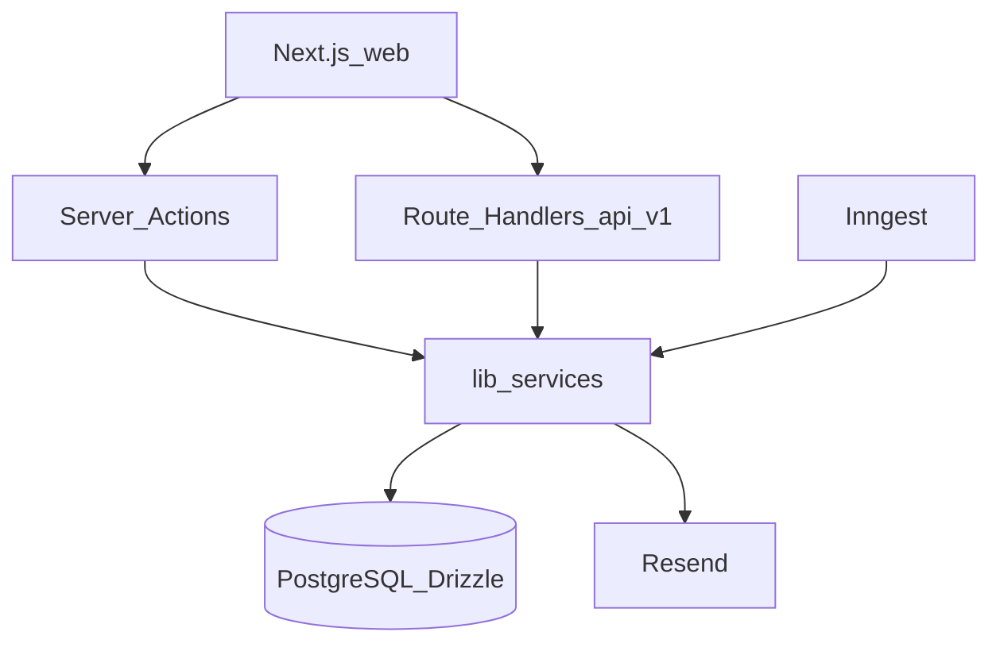

# Orbit

What the product contains and the rules it follows. Vocabulary: [`CONTEXT.md`](../CONTEXT.md). Physical schema: [`docs/data-model.md`](./data-model.md), with [`lib/db/schema.ts`](../lib/db/schema.ts) as the source of truth.

## 1. Product

Orbit is a household-first coordination app for day-to-day to-dos and recurring monthly obligations. Solo use works through a Personal Space. Sharing is part of the product.

The marketing page at `/` is shown to guests and to verified sessions. Neither is redirected into a Space automatically. A verified call to action opens that person's entry Space on Upcoming.

Inside a Space the nav order is **Upcoming, Daily, Monthlies, then custom Sections**. There is no Shared tab. The sidebar lists Spaces, with **View all** opening the directory at `/spaces/all`. The directory Home link opens the entry Space on Upcoming.

## 2. Stack

| Layer | Choice |
| ----- | ------ |
| App | Next.js App Router, TypeScript, React |
| UI | Orbit tokens (CSS variables / Tailwind) |
| Auth | Better Auth: email/password, Google, and Microsoft |
| DB | PostgreSQL + Drizzle (`DATABASE_URL`) |
| Email | Resend |
| Jobs | Inngest |
| Host | Vercel |

The web UI calls Server Actions. `/api/v1` Route Handlers are the HTTP API for the same domain services. Both validate with Zod. API auth is the Better Auth session.

- **`/api/v1`** covers spaces, sections, tasks, monthlies, notes, members, invites, and reminder preferences.
  - Invites: `GET /api/v1/spaces/{spaceId}/invites` lists pending Invites for the Owner; `POST /api/v1/spaces/{spaceId}/invites` creates one; `POST /api/v1/invites/{inviteId}/resend` refreshes expiry; `POST /api/v1/invites/accept` accepts with the bearer token. Owner cancellation is the `cancelInvite` Server Action, which deletes a pending or expired Invite. The old link shows Invite unavailable. There is no cancel REST route.
- **Server Actions** are the web's path for the same services. Task due dates, Monthly body, and content delete use the existing Server Actions and the existing Monthly REST handlers. Web Task move uses a Server Action. REST already has `POST /api/v1/spaces/{spaceId}/tasks/{taskId}/move`, and there is not a second move route. Activity reads are Server Actions. There is no Activity REST read route.

Environment variables are listed in [`.env.example`](../.env.example).

## 3. Accounts

- Sign up and sign in use email and password, Google, or Microsoft.
- An email/password user verifies their email before using Spaces. OAuth counts as verified. Until then the session is sent to `/verify-email`.
- Password reset and a signed-in password change are both supported. Mail goes through Resend.
- The signed-in shell requires a session. The user can sign out.

## 4. Spaces and membership

- A verified user who has no Space membership receives a Personal Space named Personal, with Daily and Monthlies, on entry. A user who already belongs to a Space does not receive one on entry. Its timezone is the IANA zone recorded in the browser at sign-in, or UTC when that zone is missing. The Owner can change the timezone later.
- The Personal Space cannot be renamed or deleted.
- A user may create more Spaces. The creator is the Owner. Each new Space starts with Daily and Monthlies.
- **Active Space**: one at a time. Upcoming, Daily, Monthlies, and custom Sections all show that Space.
- Roles are Space-wide: **owner**, **editor**, or **read-only**. A Space has a single Owner.
- **Read-only** can view and cannot complete, reopen, create, edit, or delete content, and cannot change membership.
- **Editor** can change content and custom Sections, including permanent delete after one confirmation. An Editor cannot change membership.
- **Owner** can invite, change roles, remove Members, transfer ownership, and rename, delete, or change settings on a non-Personal Space.
- Every Member, including Read-only, can update their own Reminder preference for that Space.
- **Invite**: email and role. The default role is read-only. An Invite cannot grant Owner. It expires after 7 days. The Owner can list, resend, and cancel. Cancel deletes the row, and the old link shows Invite unavailable. One pending Invite exists per email per Space. Accepting creates the Member. Until then the Invite is not a Member.
- An Owner who leaves a Space that still has Members must transfer ownership first. The former Owner becomes an Editor. A Space with only the Owner is deleted instead of left without an Owner. A user cannot delete or leave their last remaining Space.
- A Task or Monthly may have an **Assignee**. Any Member of that Space can be assigned, including a Read-only Member. Assignment is not edit permission.

## 5. Content

**Daily and Monthlies are separate domains.** Moving a row does not turn a Task into a Monthly or the reverse. The wrong kind is deleted and created again.

| Concept | Rules |
| ------- | ----- |
| **Daily** | System Section. Tasks only. Cannot be renamed, deleted, or retyped. |
| **Monthlies** | System Section. Monthlies only. Cannot be renamed, deleted, or retyped. |
| **Task** | Lives in Daily or in a custom `tasks` or `mixed` Section. Optional one-shot due date: set, change, or clear. A past date stays valid. Completion keeps the date. No monthly recurrence. May move among Daily and custom task or mixed Sections. Completing a Task leaves it complete until someone reopens or deletes it. Completed Tasks are hidden until show-completed is on. |
| **Monthly** | Lives only in Monthlies, in the `monthly` table. Due day of the month. Completing one finishes the current period and advances to the next month. A day that does not exist in a month clamps to that month's last day. Optional plain-text Description, stored as `body` and defaulting to `""`. The Description is shown in Monthlies only, not in Upcoming or Reminder emails. |
| **Note** | Lives in a `notes` or `mixed` Section. Title and plain-text body. Many Notes per Section. No assignee, reminder, or completion. |
| **Custom Section** | Kind is `tasks`, `notes`, or `mixed`. An Editor or Owner can create, rename, reorder, and delete them. System Sections stay above custom Sections and are not reordered with them. |
| **Upcoming** | Read-only view of Monthlies by next due date and Tasks that have a due date, across Sections in the Active Space. Not a Section. Nothing is added into Upcoming. |

Quick-add targets the Section the user is in. Upcoming has no quick-add.

Editor and Owner can permanently delete Tasks (including completed Tasks), Monthlies, and Notes after one confirmation. Read-only Viewers do not see delete controls.

### Activity

A mutation of a Task, Monthly, Note, or custom Section appends Activity in the same transaction as the change. Domain services write it; Server Actions and Route Handlers do not. Every Member can read it, including Read-only. Read-only Members still cannot mutate. A Monthly completion stores the period that was completed and the previous completion fields (`nextDueOn`, `lastCompletedAt`, `lastCompletedBy`). Activity is not a nav item. The Space-wide control is labeled Activity. A Task or Monthly row labels that entity's Activity as History.

There is no `source` column. Actions and REST are both the Member, so the service has no meaningful origin to store. There is no retention delete. Pagination bounds reads. A prune must keep Monthly `completed` rows, because those rows hold the period and the previous completion fields. Web reads are Server Actions. There is no Activity REST read route.

## 6. Reminders

- Channel is email, through Resend. The runner is one hourly Inngest cron.
- **Monthly**: N days before the due date. The default is 3. Each Member sets N for themselves in that Space, from 0 through 30, and can turn email off.
- **Tasks**: one nudge for an incomplete Task in Daily or a custom Section that is due today or up to 3 days overdue.
- The recipient is the Assignee when that person is still a Member of the Space. Otherwise the recipient is the Owner. A Member who has turned email off is not mailed.
- Sends are idempotent through `notification_log`. A retry does not send a second email.
- The same mailer sends Invite email, address verification, and password reset.

## 7. Data model

The logical rows are below. Columns, keys, and delete behavior are in [`docs/data-model.md`](./data-model.md). Better Auth adds `user`, `session`, `account`, `verification`, and `rate_limit`.

- `space`: name, timezone, whether it is the Personal Space.
- `space_member`: user, Space, role.
- `invite`: Space, email, role, `token_digest` (SHA-256 of the bearer; the raw bearer is never stored), expiry.
- `section`: Space, name, kind (`daily`, `monthlies`, `tasks`, `notes`, or `mixed`), whether it is a system Section, order.
- `task`: a Task in Daily or a custom tasks or mixed Section. A Task cannot be stored in Monthlies.
- `monthly`: a Monthly in a Monthlies Section. A Monthly cannot be stored anywhere else.
- `note`: a Note in a notes or mixed Section. Title and plain-text body.
- `notification_preference`: user, Space, days before, email on or off.
- `notification_log`: one row per send, keyed so a retry cannot double-send.
- `activity`: who did what to a Task, Monthly, Note, or Section. The row survives deletion of that entity (`entity_id` is not a foreign key). `period` is a date and is set only for Monthly completion.
